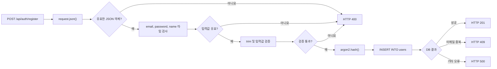

# 회원가입 (Register)

## 1. API 정보

| 항목 | 내용 |
|---|---|
| Method | POST |
| Endpoint | `/api/auth/register` |
| Route Handler | `web/src/app/api/auth/register/route.ts` |
| DB 연결 | `web/src/lib/db/pool.ts` |
| DB 테이블 | `public.users` |

## 2. 실행 흐름

## 3. 핵심 처리 단계

| 순서 | 처리 | 관련 코드 |
|---|---|---|
| 1 | 요청 JSON 파싱 | `request.json()` |
| 2 | 객체 및 타입 검사 | `typeof`, `Array.isArray()` |
| 3 | 문자열 정규화 | `trim()` |
| 4 | 입력값 검증 | 정규표현식, 길이 검사 |
| 5 | 비밀번호 해싱 | `argon2.hash()` |
| 6 | 사용자 저장 | `pool.query()` |
| 7 | 결과 반환 | `Response.json()` |

## 4. HTTP 응답

| 상태 | 오류 코드 | 설명 |
|---|---|---|
| 200 OK | 없음 | 요청 처리 성공 |
| 201 Created | 없음 | 회원가입 성공 |
| 400 Bad Request | VALIDATION_ERROR | JSON 형식 오류, 입력값 타입 또는 유효성 검증 실패 |
| 401 Unauthorized | UNAUTHORIZED | 인증되지 않은 사용자 |
| 403 Forbidden | FORBIDDEN | 인증되었지만 해당 작업을 수행할 권한이 없음 |
| 404 Not Found | NOT_FOUND | 요청한 리소스가 존재하지 않음 |
| 409 Conflict | EMAIL_ALREADY_EXISTS | 이미 등록된 이메일 |
| 500 Internal Server Error | INTERNAL_ERROR | 예상하지 못한 서버 내부 오류 |
| 503 Service Unavailable | DATABASE_UNAVAILABLE | 데이터베이스 연결 실패 등 서비스 일시 장애 |

## 5. 관련 소스코드

- [회원가입 Route Handler](../../../web/src/app/api/auth/register/route.ts)
- [API 응답 타입](../../../web/src/types/api.ts)
- [DB Connection Pool](../../../web/src/lib/db/pool.ts)
- [users 테이블 Migration](../../../migrations/001_create_users.sql)